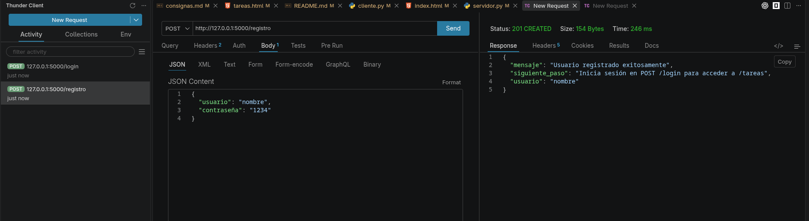
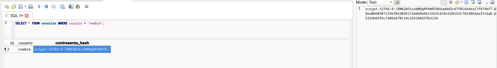
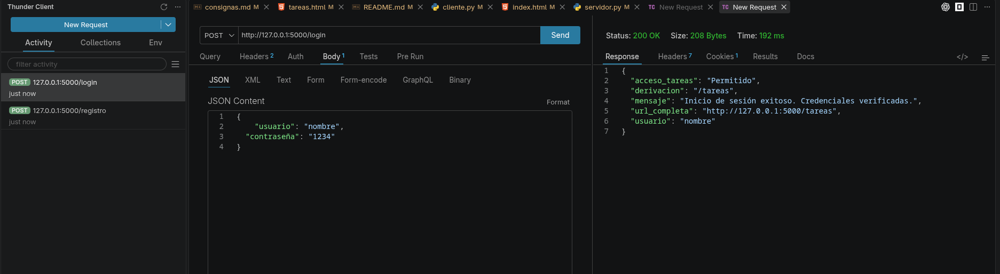
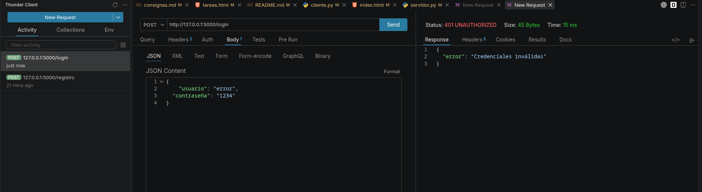
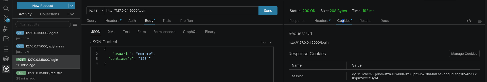
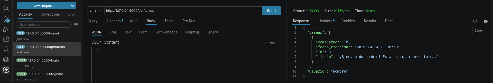
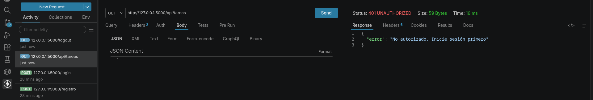
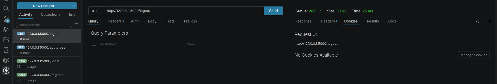

# Programación sobre Redes

- **Materia:** Programación sobre Redes
- **Curso:** 3° E
- **Alumno:** Novillo Guillermo Tadeo
- **Repositorio:** [https://github.com/guinovi/pr_pfo_02](https://github.com/guinovi/pr_pfo_02)
- **GitHub Pages:** [https://guinovi.github.io/pr_pfo_02/](https://guinovi.github.io/pr_pfo_02/)

---

## PFO 2: Sistema de Gestión de Tareas con API y Base de Datos

Trabajo práctico N°2 que implementa una **API REST con Flask**, autenticación segura con **contraseñas hasheadas** (mediante `werkzeug.security`), almacenamiento persistente en **SQLite** y un **cliente interactivo por consola**.

---

## 📌 Tabla de Contenidos
1. [Estructura del Proyecto](#-estructura-del-proyecto)
2. [Instalación y Configuración](#-instalación-y-configuración)
3. [Instrucciones de Ejecución](#-instrucciones-de-ejecución)
4. [Documentación de Endpoints](#-documentación-de-endpoints)
5. [Evidencia de Pruebas Exitosas](#-evidencia-de-pruebas-exitosas)
6. [Respuestas a Preguntas Conceptuales](#-respuestas-a-preguntas-conceptuales)

---

## 📂 Estructura del Proyecto

```text
tp2/
├── servidor.py          # API Flask con SQLite y contraseñas hasheadas
├── cliente.py           # Cliente interactivo en consola (requests)
├── test_servidor.py     # Suite de pruebas unitarias (unittest)
├── templates/
│   └── tareas.html      # Plantilla HTML con Bootstrap 5 por CDN para GET /tareas
├── requirements.txt     # Dependencias de Python (Flask, Requests, Werkzeug)
├── .gitignore           # Archivos ignorados por Git
├── index.html           # Presentación y simulador web para GitHub Pages
└── README.md            # Documentación y respuestas conceptuales
```

---

## ⚙️ Instalación y Configuración

### 1. Clonar el repositorio
```bash
git clone <URL_DEL_REPOSITORIO>
cd tp2
```

### 2. Crear y activar entorno virtual
En Linux / macOS:
```bash
python3 -m venv .venv
source .venv/bin/activate
```
En Windows:
```cmd
python -m venv .venv
.venv\Scripts\activate
```

### 3. Instalar dependencias
```bash
pip install -r requirements.txt
```

---

## 🚀 Instrucciones de Ejecución

### Opción Rápida: Lanzar Servidor + Cliente Todo Junto ⭐
Hemos creado un lanzador unificado ([`iniciar.py`](iniciar.py) / [`iniciar.sh`](iniciar.sh)) que:
1. Levanta el servidor Flask en segundo plano.
2. Abre automáticamente la página web en tu navegador.
3. Inicia el cliente interactivo en consola.
4. Al salir, apaga el servidor limpiamente.

En Linux / macOS:
```bash
./iniciar.sh
# O también:
python iniciar.py
```

En Windows:
```cmd
python iniciar.py
```

---

### Opción Manual (En terminales separadas):

#### 1. Iniciar el Servidor API
En una terminal:
```bash
python servidor.py
```
El servidor iniciará en: `http://127.0.0.1:5000` (redirige automáticamente a `/tareas`).

#### 2. Ejecutar el Cliente en Consola
En una segunda terminal (con el entorno virtual activo):
```bash
python cliente.py
```
El cliente da la bienvenida, muestra las credenciales por defecto e inicia sesión derivando automáticamente al navegador y listando las tareas.

#### 3. Ejecutar Pruebas Automatizadas
```bash
python test_servidor.py
```

---

## 🔑 Credenciales por Defecto (Para Evaluación)
Al iniciar la base de datos se crea automáticamente el usuario de evaluación:
- **Usuario:** `usuario`
- **Contraseña:** `12345` (almacenada como hash `scrypt` en SQLite)

Al enviar `POST /login` con estas credenciales, el servidor valida el hash y deriva el acceso directamente a `GET /tareas`.

---

## 📡 Documentación de Endpoints

| Método | Endpoint | Descripción | Formato |
|---|---|---|---|
| `POST` | `/registro` | Registra usuario con contraseña hasheada en SQLite | JSON / Form |
| `POST` | `/login` | Verifica credenciales, inicia sesión y deriva a `/tareas` | JSON / Form |
| `GET` | `/tareas` | Vista HTML de bienvenida con CRUD interactivo (Bootstrap CDN) | HTML |
| `GET` | `/api/tareas` | Lista las tareas del usuario autenticado | JSON |
| `POST` | `/api/tareas` | Crea una nueva tarea | JSON |
| `PUT` | `/api/tareas/<id>` | Actualiza título o estado de una tarea | JSON |
| `POST` | `/api/tareas/<id>/toggle` | Alterna estado de la tarea (Pendiente ⇄ Realizada) | JSON / Form |
| `DELETE`| `/api/tareas/<id>` | Elimina una tarea | JSON |
| `POST` | `/logout` | Cierra la sesión activa | JSON / Form |

---

## 📸 Evidencia de Pruebas Exitosas (Capturas de Pantalla)

A continuación se presentan las capturas de pantalla de las pruebas funcionales realizadas con **Thunder Client** y la verificación directa en la base de datos **SQLite**:

### 1. Registro de Usuario Exitoso (`POST /registro` → `201 Created`)
Se envía el JSON con las credenciales. El servidor procesa la petición, hashea la contraseña y responde con `201 Created`:


### 2. Verificación de Contraseña Hasheada en SQLite
Consulta directa al archivo `gestor_tareas.db`. Se demuestra que la contraseña nunca se guarda en texto plano, sino como un hash criptográfico `scrypt` con sal única:


### 3. Inicio de Sesión Exitoso (`POST /login` → `200 OK`)
Validación correcta de credenciales. La respuesta confirma el acceso y deriva a la vista de tareas:


### 4. Rechazo de Credenciales Inválidas (`POST /login` → `401 Unauthorized`)
Si el usuario no existe o la contraseña no coincide con el hash almacenado, el acceso es denegado:


### 5. Asignación de Cookie de Sesión
Al autenticarse correctamente, Flask genera y envía la cookie firmada `session` para mantener la sesión activa:


### 6. Consulta de Tareas con Autenticación (`GET /tareas` → `200 OK`)
Petición autorizada que devuelve el HTML de bienvenida con Bootstrap y las tareas del usuario:


### 7. Protección de Rutas (`GET /api/tareas` no autenticado → `401 Unauthorized`)
Si se intenta acceder a las tareas sin haber iniciado sesión previamente, la API bloquea el acceso:


### 8. Cierre de Sesión (`POST /logout` → `200 OK`)
Cierre de sesión seguro y eliminación de credenciales activas:


---

### 9. Pruebas Unitarias Automatizadas (`test_servidor.py`)
```text
$ python test_servidor.py
.....
----------------------------------------------------------------------
Ran 5 tests in 3.392s

OK
```
*Comprueba automáticamente:*
1. Registro y generación de hash `scrypt`.
2. Validación de campos obligatorios y bloqueo de duplicados (`409`).
3. Login con credenciales válidas e inválidas (`401`).
4. Renderizado de `/tareas` con plantilla HTML y Bootstrap.
5. Ciclo CRUD completo de tareas (crear, listar, cambiar estado y eliminar).

---

## 💡 Respuestas a Preguntas Conceptuales

### 1. ¿Por qué hashear contraseñas?

Hashear contraseñas es el estándar ineludible de seguridad informática para el manejo de credenciales por las siguientes razones:

1. **Naturaleza Unidireccional (One-Way):**
   Una función de hash criptográfico transforma cualquier texto plano en una cadena fija que es matemáticamente imposible de revertir. A diferencia del cifrado (que tiene una clave para desencriptar), el hash no se puede revertir para obtener la contraseña original.
2. **Protección ante Filtraciones de Base de Datos (Data Breaches):**
   Si la base de datos es vulnerada o filtrada (inyección SQL, accesos indebidos, backups expuestos), los atacantes solo obtendrán cadenas de hashes, protegiendo las contraseñas reales de los usuarios.
3. **Defensa contra la Reutilización de Contraseñas:**
   Muchos usuarios utilizan la misma contraseña en múltiples sitios (correo, home banking, redes sociales). Almacenarlas hasheadas evita que una brecha en nuestro sistema comprometa sus cuentas en otras plataformas.
4. **Salting contra Ataques de Tablas Arcoíris (Rainbow Tables):**
   Librerías como `werkzeug.security` aplican automáticamente una "sal" criptográfica (valor aleatorio único por cada usuario). Esto asegura que dos contraseñas idénticas produzcan hashes completamente diferentes y neutraliza los ataques masivos mediante diccionarios precalculados.

---

### 2. Ventajas de usar SQLite en este proyecto

SQLite es un motor de base de datos relacional embebido que ofrece grandes ventajas en este contexto:

1. **Sin Servidor (Serverless) y Cero Configuración:**
   No requiere instalar, configurar ni mantener un proceso demonio en segundo plano (como MySQL o PostgreSQL), ni gestionar puertos de red ni usuarios de conexión.
2. **Persistencia en un Archivo Único y Máxima Portabilidad:**
   Toda la base de datos reside en el archivo local `gestor_tareas.db`. Esto permite clonar o mover el proyecto entero entre computadoras y sistemas operativos (Linux, Windows, macOS) simplemente copiando el repositorio.
3. **Integración Nativa en Python:**
   Python incluye el módulo `sqlite3` por defecto en su biblioteca estándar, eliminando la necesidad de controladores externos.
4. **Cumplimiento de Estándares ACID:**
   Garantiza Atomicidad, Consistencia, Aislamiento y Durabilidad, asegurando que las transacciones mantengan la integridad de los datos ante cierres inesperados.
5. **Rendimiento Óptimo para Entornos Académicos:**
   Brinda tiempos de respuesta instantáneos y un consumo mínimo de memoria RAM, ideal para prototipos y aplicaciones de escala ligera/mediana.


